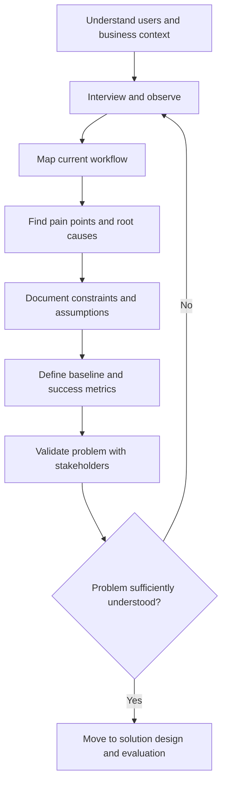
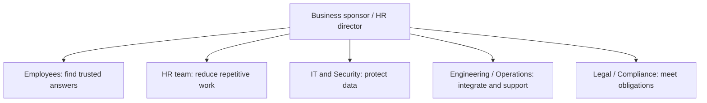
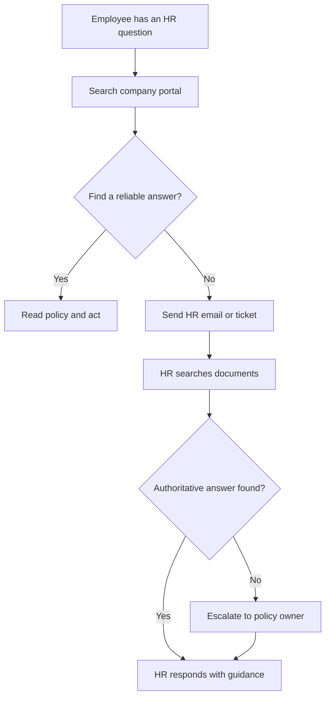
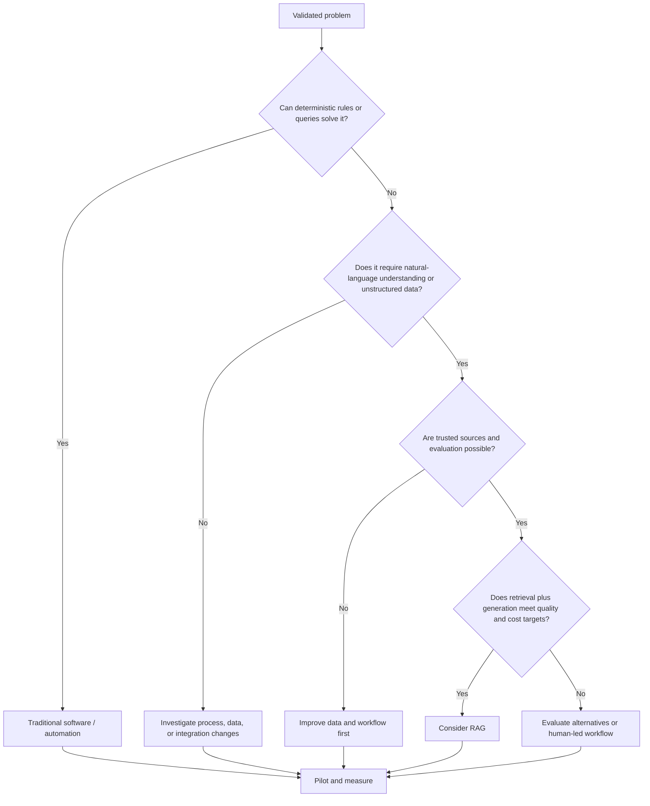
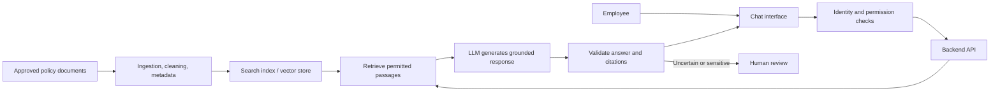

# 🔎 01 · Problem Discovery

> **Start with the user's workflow, constraints, and measurable outcome—before choosing technology.**

Problem discovery is the first step in the Forward-Deployed AI Engineer (FDE) workflow. It helps a team understand the real business problem, who experiences it, why it happens, what evidence supports it, and how success will be measured. The output is a validated problem definition—not an assumption that every problem needs AI.

## 🎯 Learning objectives

By the end of this module, you should be able to:

- Write a clear, evidence-based problem statement.
- Identify stakeholders and understand their different needs.
- Map the current-state workflow and find bottlenecks.
- Record technical, business, security, privacy, and operational constraints.
- Define measurable success metrics and a baseline.
- Track open questions, assumptions, risks, and validation activities.
- Decide whether the problem calls for traditional software, search, RAG, an AI agent, or a human-led process.

## 🧭 The problem-discovery process



**Core principle:** Do not begin with “Which LLM should we use?” Begin with “What is difficult for the user today, what evidence proves it, and what outcome matters?”

---

## 🏢 Running example: Enterprise HR Knowledge Assistant

The following scenario and numbers are **illustrative assumptions for learning**, not measured results from a real company.

A company has 1,000 employees. Employees ask HR repetitive questions about leave, benefits, reimbursements, and company policies. Information is spread across PDFs, email threads, and an internal portal.

Assume the team receives **200 questions per day**, and each question requires an average of **8 minutes of active handling**.

- Daily effort: 200 × 8 = 1,600 minutes = **26.7 hours**
- Monthly effort (20 working days): 26.7 × 20 = **533.3 hours**

These numbers estimate handling effort, not elapsed resolution time or guaranteed savings. Validate them using representative records before making a business case.

### Initial request vs. discovered problem

**Initial request:** “We need an AI chatbot for HR.”

That is a proposed solution. Discovery may reveal that employees cannot find the current policy, HR repeats the same answers, multiple document versions conflict, and some requests involve confidential employee-specific information.

**Problem statement:** Employees struggle to find accurate, current HR policy information because authoritative documents are distributed across repositories and versions. This delays employees and creates repetitive HR work. The company wants to reduce the time needed to resolve routine questions while preserving answer quality, access permissions, privacy, and traceability.

A possible target is to reduce average handling time by 50%. Treat this as a hypothesis until a pilot validates it.

## 1. 📝 Deliverable: Problem statement

A good problem statement names the user, the difficulty, the root cause, the impact, the desired outcome, and the constraints. Avoid prescribing technology too early.

### Template

> For **[user group]**, the problem is **[specific difficulty]** because **[root cause]**. This leads to **[business impact]**. We will consider the problem improved when **[measurable outcome]** is achieved without violating **[constraints]**.

### Weak vs. strong

| Weak | Strong |
|---|---|
| We need a chatbot. | Employees struggle to find current, authoritative HR policies. |
| We need RAG. | HR spends substantial time answering repeated questions and locating source documents. |
| The model should answer everything. | Routine policy questions should be answered accurately with approved sources; sensitive or uncertain cases should be escalated. |

### Example acceptance statement

Reduce routine-question handling time against a measured baseline, meet agreed answer-quality and source-support thresholds, and prevent unauthorized disclosure. Define each metric, its denominator, test dataset, and measurement period before the pilot.

## 2. 👥 Deliverable: Stakeholder map

Stakeholders include people who use, operate, approve, fund, maintain, or are affected by the solution. Interview multiple roles; the sponsor's view alone may not describe the user's real workflow.



| Stakeholder | Needs and concerns | Questions to ask |
|---|---|---|
| Business sponsor | Business value, cost, adoption | Which outcome matters most? |
| Employees | Fast, understandable, reliable answers | Show me the last time you searched for a policy. |
| HR specialists | Correct interpretation, fewer repetitive tickets | Which questions repeat? Which require expert judgment? |
| Policy owners | Authoritative and current documents | Who approves updates and retires old versions? |
| IT / Security | Identity, permissions, audit, data protection | How are access rights enforced today? |
| Engineering / Operations | Integration, reliability, supportability | Which systems and service-level targets apply? |
| Legal / Compliance | Privacy, retention, auditability | What information must be protected or retained? |

**Technique:** Interview stakeholders separately, compare answers, and investigate disagreements. Treat claims as assumptions until supported by data or direct observation.

## 3. 🔄 Deliverable: Current-state workflow

Document what people do **today**, before the proposed solution. Capture steps, decisions, hand-offs, delays, rework, and failure paths.



| Workflow step | Possible bottleneck | Evidence to collect |
|---|---|---|
| Search portal | Poor search or unclear document titles | Search logs, observation, failed queries |
| Read policy | Long documents or conflicting versions | Time-on-task, version history |
| Create ticket | Repeated questions | Ticket categories and volumes |
| HR investigates | Manual search across repositories | Handling-time samples |
| Respond | Waiting or inconsistent guidance | First-response and resolution timestamps |

**Measure both:**
- **Active handling time:** time spent doing the work.
- **Elapsed resolution time:** total time from request to resolution, including waiting.

An eight-minute task can still take a day to resolve if it sits in a queue. Do not treat these measures as interchangeable.

## 4. 🧱 Deliverable: Constraints register

Constraints are requirements or limitations the solution must respect. They are not optional polish; they influence feasibility and architecture.

| Area | Example constraint | How to validate |
|---|---|---|
| Security and privacy | Employees must not see documents outside their permissions | Test access using multiple roles and restricted documents |
| Data quality | Documents may be outdated, duplicated, scanned, or missing metadata | Audit a representative sample and confirm document ownership |
| Budget | Hosting, model calls, indexing, and maintenance must fit a defined budget | Estimate and load-test expected usage |
| Latency and availability | Responses must meet agreed service targets | Measure end-to-end latency and dependency failures |
| Integration | Existing identity provider and document stores must be used | Review APIs, authentication, and deployment environment |
| Governance | Sensitive or ambiguous cases need human review | Define escalation categories and owners |
| Auditability | Answers need traceable source references | Verify citations link to approved source passages |

Record an owner, evidence, and a test for every important constraint. Access control must apply to retrieval itself—not only to the final answer.

## 5. 📏 Deliverable: Success metrics

Define success before building. Use a baseline, target, metric definition, data source, owner, and measurement period.

| Category | Example metric | Baseline | Illustrative target |
|---|---|---|---|
| Efficiency | Average active handling time | Measure first | Reduce from 8 to 4 minutes |
| Resolution | Routine questions resolved without further assistance | Measure first | Improve against baseline |
| Quality | Correctness on representative test questions | Measure first | At least 95%, if suitable |
| Grounding | Answers supported by approved sources | Measure first | At least 98%, if suitable |
| Adoption | Weekly active users / eligible users | Measure first | Set after pilot |
| Safety | Unauthorized disclosures | Measure first | Zero |
| Cost | Total cost per resolved question | Measure first | Within agreed budget |
| Satisfaction | User rating or survey score | Measure first | Improve against baseline |

Targets above are proposed examples, not industry standards. Agree on evaluation criteria with stakeholders and test against a representative dataset.

### Example calculation

If 200 questions take 8 minutes each, the baseline is 1,600 minutes/day. If the measured average handling time becomes 4 minutes, effort becomes 800 minutes/day.

- Potential reduction: (1,600 − 800) ÷ 1,600 = **50%**
- Potential time saved: 800 minutes/day = **13.3 hours/day**

This is a hypothetical scenario. Real results depend on eligible question types, adoption, escalations, review effort, and operating overhead.

### Do not confuse these metrics

- **Answer rate:** questions receiving an answer.
- **Correctness:** answers judged factually correct.
- **Groundedness:** answers supported by cited evidence.
- **Resolution rate:** requests resolved without additional help.
- **Safe completion:** requests handled without prohibited disclosure or action.

A high answer rate does not prove that the answers are correct or useful.

## 6. ❓ Deliverable: Open questions and assumptions

An open-question register makes uncertainty visible and assigns a way to resolve it.

| Question or assumption | Why it matters | Validation method |
|---|---|---|
| Which source is authoritative? | Prevents conflicting answers | Confirm with policy owners |
| How often do policies change? | Determines update and re-indexing needs | Review document lifecycle |
| Do permissions differ by role? | Prevents unauthorized retrieval | Review identity and access rules |
| Which questions must go to a person? | Defines safe scope | Agree on escalation policy |
| What fraction of tickets is routine? | Determines potential value | Analyze anonymized ticket samples |
| Will employees trust the assistant? | Affects adoption | Run usability tests and a pilot |
| What latency and cost are acceptable? | Shapes architecture | Agree on service and budget targets |

Prioritize uncertainties by **impact if wrong** and **how little evidence you have**. Resolve security and high-impact workflow uncertainties before low-impact interface preferences.

## 7. 🧠 Choose the right solution only after discovery

Not every problem requires AI. Select the simplest approach that satisfies the validated requirements.



### Common solution patterns

1. **Traditional automation:** calculate leave balances from structured records using deterministic rules.
2. **Search or RAG:** retrieve relevant approved policy passages and use an LLM to explain them with source citations.
3. **Tool-assisted AI workflow:** interpret a request, retrieve policy, call a permission-controlled API, and prepare an action for approval where needed.

An agent is justified only when multi-step reasoning or controlled tool use is genuinely necessary. A pilot should compare quality, cost, latency, and operational complexity with simpler alternatives.

### Example RAG architecture (a candidate, not a predetermined requirement)



This architecture is a starting point for solution design. Retrieval permissions, document freshness, answer evaluation, and escalation must be tested; citations alone do not guarantee correctness.

## 8. 🗣️ Customer discovery interview guide

Ask about real experiences and observable behavior instead of leading users toward a solution.

**Understand the problem**
- Tell me about the last time you needed this information.
- What were you trying to accomplish?
- What happened when you could not find the answer?

**Understand the workflow**
- Can you walk me through each step?
- Which systems, documents, and people were involved?
- Where did you wait, repeat work, or ask for help?

**Understand impact**
- How often does this happen?
- How much active effort does a typical case require?
- What happens if the answer is late or wrong?

**Understand constraints**
- Which sources are authoritative?
- What information must a user never access?
- Which cases require a human or authorized approver?

**Define success**
- What measurable improvement would matter?
- What is the current baseline?
- How will we know the solution is accurate, safe, useful, and affordable?

Where permitted, observe representative work and use appropriately anonymized records. Minimize collection of sensitive production data and agree on access, consent, retention, and redaction with the customer.

## 9. 🧪 Hands-on portfolio assignment

**Project:** Enterprise Knowledge Assistant — Discovery Phase

Create the following deliverables for the hypothetical HR scenario:

- [ ] Problem statement: user, difficulty, root cause, impact, target.
- [ ] Stakeholder map: roles, needs, influence, and interview questions.
- [ ] Current-state workflow: steps, decisions, hand-offs, and bottlenecks.
- [ ] Constraints register: security, privacy, data, integration, cost, latency, governance.
- [ ] Success metrics: baseline, target, definition, data source, owner.
- [ ] Open-question register: uncertainty, impact, validation method, owner.
- [ ] Interview guide: non-leading questions for users and stakeholders.
- [ ] Solution decision: explain why traditional search, automation, RAG, an agent, or a hybrid is appropriate—or why more discovery is needed.

### Suggested folder structure

```text
01-problem-discovery/
├── README.md
├── problem-statement.md
├── stakeholder-map.md
├── current-state-workflow.mmd
├── constraints-register.md
├── success-metrics.md
├── open-questions.md
└── interview-guide.md
```

These are recommended future files; this README is the learning guide.

## 10. 🎤 Interview questions

1. What is problem discovery, and why should it happen before architecture design?
2. How do you distinguish a business problem from a proposed solution?
3. How do you identify the root cause rather than a symptom?
4. What is a stakeholder map, and how do stakeholder needs differ?
5. Why do we document the current-state workflow?
6. What is the difference between active handling time and elapsed resolution time?
7. How do you choose success metrics for an AI assistant?
8. Why is answer rate not enough to measure RAG quality?
9. How would you identify security and data-quality constraints?
10. When would you choose traditional automation instead of an LLM?
11. When is RAG appropriate, and what assumptions must be validated?
12. How do you prioritize open questions and risks?
13. How would you validate business value in a pilot?
14. What would make you recommend **not** building an AI solution?

## ✅ Completion checklist

You are ready to move to solution design when you can:

- Explain the problem in plain language with supporting evidence.
- Identify users, stakeholders, and their competing needs.
- Show the current workflow and its measured bottlenecks.
- Document constraints, assumptions, and unresolved questions.
- Define measurable success criteria and a baseline.
- Justify a solution choice without assuming AI is always needed.
- Explain how a pilot will evaluate quality, safety, adoption, cost, and business value.

**Next stage:** Use these discovery artifacts to guide solution design, data assessment, architecture selection, and pilot evaluation. Keep assumptions clearly labeled until verified.

---

### Further reading

- [Forward-Deployed AI Engineer repository](https://github.com/amitweb2012/forward-deployed-ai-engineer)
- [Problem Discovery folder](https://github.com/amitweb2012/forward-deployed-ai-engineer/tree/main/01-problem-discovery)
